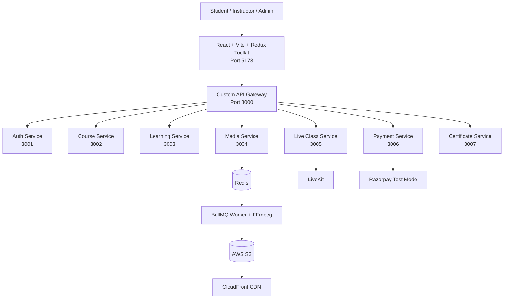

# LMS — System Architecture

## Architecture Notes

- The React frontend sends API requests through the custom API Gateway.
- The Gateway routes requests to the appropriate backend microservice.
- Redis and BullMQ manage background video-processing jobs.
- FFmpeg processes uploaded videos into HLS format.
- AWS S3 stores processed video files, and CloudFront delivers them.
- LiveKit powers live-class functionality.
- Razorpay Test Mode supports payment testing.
- Each backend service should use its configured database and environment variables.
